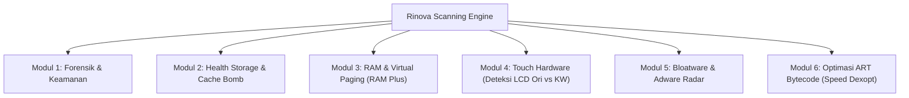

# Blueprint Arsitektur Scanner No-Root "Rinova"

Spesifikasi teknis implementasi scanning sistem Android tanpa root (*no-root environment*) berbasis Shizuku API / Wireless ADB IPC.

---

## 1. Arsitektur Eksekusi Scanner (No-Root Bridge)

Aplikasi **Rinova** dapat menjalankan perintah scanning menggunakan dua moda tanpa memerlukan akses Root:
1. **Shizuku API (Direkomendasikan)**: Menggunakan `Shizuku.newProcess(cmd, null, null)` yang berjalan pada privilege UID 2000 (`shell`).
2. **Local Wireless ADB Socket**: Membuka koneksi `Socket("127.0.0.1", adb_port)` internal dengan keypair RSA yang tersimpan di app data (`Adblib`).

---

## 2. Modul-Modul yang Wajib Masuk ke Scanner Rinova



---

### Modul 1: Forensik Sistem & Audit Spyware
Tujuan: Memeriksa apakah hp terinfeksi *stalkerware*, *keylogger*, atau berada dalam kondisi boot tidak aman.

| Target Pengecekan | Perintah Shell | Cara Parsing & Logika Deteksi |
| :--- | :--- | :--- |
| **Status Bootloader** | `getprop ro.boot.flash.locked` | `1` = Aman (Locked), `0` = Warning (Unlocked). |
| **Android Verified Boot** | `getprop ro.boot.verifiedbootstate` | `green` = Resmi, `orange`/`red`/`yellow` = Sistem sudah dimodifikasi. |
| **Audit Keylogger / Stalkerware** | `settings get secure enabled_accessibility_services` | Cek package di luar whitelist sistem. Jika ada aplikasi pihak ke-3 mencurigakan yang aktif di sini, beri tanda **BAHAYA TINGGI (Keylogger / Screen Sniffer)**. |
| **Audit Penyadapan OTP/SMS** | `settings get secure enabled_notification_listeners` | Cek aplikasi pihak ke-3 yang mendengarkan notifikasi. |
| **Audit Installer Sideload** | `pm list packages -3 -i` | Mendeteksi aplikasi yang diinstall bukan dari `com.android.vending` (Google Play Store). |

---

### Modul 2: Storage & Cache Bomb Hunter
Tujuan: Menemukan penimbun storage tersembunyi yang sering tidak terbaca oleh cleaner biasa.

1. **MIUI Gallery Cache Bomb (Khusus Xiaomi / Redmi / POCO)**:
   - **Path**: `/storage/emulated/0/Android/data/com.miui.gallery/files/ThumbnailFile`
   - **Karakteristik**: File thumbnail foto/video yang menumpuk hingga 10GB–20GB.
   - **Metode Scan**: `du -sk <path>`
   - **Metode Bersih**: Hapus seluruh file di dalam `ThumbnailFile/` dan `gallery_disk_cache/`. Foto asli di DCIM tetap 100% aman.
2. **Junk Root Storage**:
   - Pola file sampah temporary seperti `.175*`, `.176*`, `.temp*` di `/storage/emulated/0/`.
3. **Storage TRIM (Flash Health)**:
   - Jalankan `sm fstrim` untuk mengoptimalkan kembali kecepatan write eMMC/UFS yang lambat.

---

### Modul 3: RAM & Virtual Memory Bottleneck (RAM Plus / Extension)
Tujuan: Mencegah *stuttering* pada hp spesifikasi rendah/menengah.

1. **Samsung RAM Plus**:
   - **Cek**: `settings get global ram_expand_size`
   - **Kondisi**: Jika nilai > 0 pada perangkat dengan storage eMMC (seperti Galaxy A04e/A03/A14), paging memory virtual memperlambat CPU karena I/O disk lambat.
   - **Rekomendasi Rinova**: Tawarkan tombol nonaktifkan (`settings put global ram_expand_size 0`).
2. **Top RAM Hoggers**:
   - Parse `dumpsys meminfo` pada bagian `Total RSS by process:`.
   - Klasifikasikan aplikasi berdasarkan pengembang (Google, Facebook, System, User Apps).

---

### Modul 4: Touchscreen Hardware Profiler (Deteksi Layar Ori vs KW)
Tujuan: Memberikan informasi ke pengguna apakah touchscreen perangkatnya asli atau gantian (aftermarket/KW), dan mengoptimalkan responnya.

1. **Deteksi Driver & IC Touch**:
   - Jalankan: `dumpsys input`
   - Filter baris yang mengandung: `Device [0-9]:` atau `Touch Input Mapper`
   - **Database Signature**:
     - `jadard-touchscreen` ➡️ **LCD KW / Aftermarket Incell** (Touch sampling rate 60–100Hz, kapasitansi rendah).
     - `NVTCapacitiveTouchScreen` ➡️ **Novatek OEM Original** (180–240Hz).
     - `fts` / `focaltech` ➡️ **FocalTech OEM**.
     - `synaptics` ➡️ **Synaptics OEM**.
2. **Auto-Tweak untuk LCD KW**:
   - Jika terdeteksi `jadard` atau pengguna mengeluh layar kurang sensitif:
     - `settings put system touch_sensitivity 1` (Meningkatkan kepekaan kapasitif)
     - `settings put secure long_press_timeout 300` (Menurunkan delay klik dari 500ms ke 300ms)
     - `settings put system pointer_speed 3`

---

### Modul 5: Bloatware & Adware Radar Engine
Tujuan: Menghapus/menonaktifkan aplikasi sampah tanpa resiko *bootloop* menggunakan:
```bash
pm uninstall -k --user 0 <package_name>
```

#### Rule Klasifikasi Paket:
1. **TIER 1 (SAFE TO REMOVE)**:
   - Adware: `com.aura.oobe.samsung.gl`, `com.miui.msa.global`
   - Telemetry: `com.miui.analytics`, `com.miui.daemon`, `com.sec.android.diagmonagent`, `com.samsung.android.da.daagent`
   - Facebook Background: `com.facebook.system`, `com.facebook.appmanager`, `com.facebook.services`
2. **TIER 2 (OPTIONAL / USER CONFIRMATION)**:
   - Pembatas Performa Game: `com.xiaomi.joyose`, `com.samsung.android.game.gos`
   - App Store Promosi: `com.xiaomi.mipicks` (GetApps)
   - Bixby / Routines: `com.samsung.android.app.settings.bixby`, `com.samsung.android.app.routines`
3. **TIER 3 (PROTECTED - BLACKLISTED FROM DELETION)**:
   - `com.android.systemui`, `com.android.settings`, `com.google.android.gms`, `com.miui.securitycenter` *(Menghapus ini akan menyebabkan bootloop / error fatal)*.

---

### Modul 6: Speed-Profile ART Compilation (Dexopt Booster)
Tujuan: Mempercepat waktu buka (*launch time*) dan mengurangi stutter aplikasi utama.

Eksekusi kompilasi native bytecode:
```bash
cmd package compile -m speed-profile <package_name>
```
Diterapkan khusus untuk aplikasi esensial:
- System Launcher (`com.sec.android.app.launcher` / `com.miui.home`)
- WhatsApp / WhatsApp Business (`com.whatsapp`, `com.whatsapp.w4b`)
- Media sosial & browser aktif
