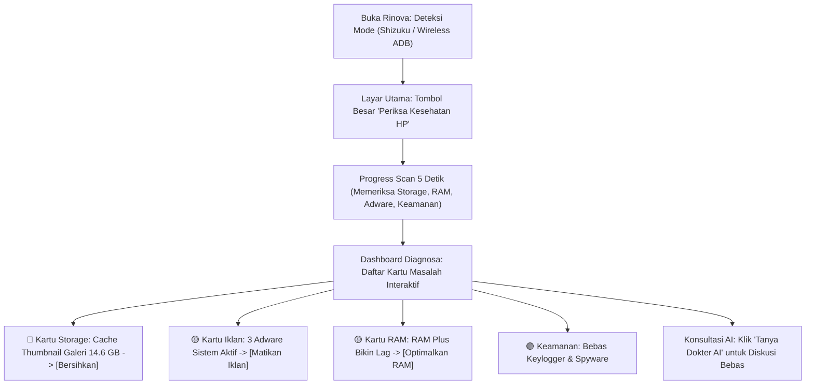

# Blueprint Arsitektur UI/UX & AI Engine Rinova (Roadmap Implementasi)

Dokumen ini memuat kesepakatan desain, restrukturisasi alur UI/UX, dan refactor fitur AI Rinova agar ramah bagi pengguna awam (*non-technical friendly*), mudah dikembangkan, dan aman dari *reverse engineering*.

---

## 1. Ringkasan Perubahan Filosofi Produk (Design Pivot)

| Aspek | Desain Lama (Kaku / Terlalu Teknis) | Desain Baru (Ramah Pengguna / Pintar) |
| :--- | :--- | :--- |
| **Target Pengguna** | Teknisi Android / Modder | Pengguna Biasa & Teknisi (Dual Mode) |
| **Gerbang Awal** | Form manual IP, Port 5555, Pairing Code | Mode Deteksi Otomatis + Panduan visual 1-klik |
| **Navigasi Utama** | 4 Tab Terpisah (Ikhtisar, Storage, Keamanan, Optimasi) | **1-Click Smart Health Check** (Dokter HP Pintar) |
| **Output Temuan** | Kode perintah shell mentah (`pm uninstall -k ...`) | **Kartu Masalah Interaktif Bahasa Manusia** + Tombol Aksi |
| **Fitur AI** | Generator laporan JSON statis sekali klik | **Interactive Co-Pilot Chat**: Analisis fakta, saran berbobot, validasi user, dan kartu eksekusi aman |
| **Keamanan API Key** | Form input API Key dipajang di halaman diagnosa | **BYOK (Bring Your Own Key)** di Pengaturan tersembunyi + Enkripsi Keystore Lokal |

---

## 2. Restrukturisasi Alur UI/UX (User Journey Baru)



### Panduan Tampilan Bahasa (Anti-Jargon):
- **JANGAN**: Menampilkan sintaks command terminal di dialog konfirmasi utama pengguna awam (misal: `pm uninstall -k --user 0 com.aura.oobe.samsung.gl`).
- **GUNAKAN**: Penjelasan bersahabat dan menenangkan:
  > *"Menonaktifkan aplikasi sponsor otomatis Aura. 100% aman, tidak ada foto atau chat yang terhapus, dan bisa diaktifkan kembali kapan saja."*

---

## 3. Desain Arsitektur Baru Fitur AI (Interactive Co-Pilot)

### A. Konsep Dialog Interaktif:
AI tidak lagi dipaksa menghasilkan satu file JSON diagnosa raksasa yang kaku. AI bekerja sebagai **konsultan pendamping**:
1. User dapat bertanya bebas (multi-turn conversation via `LazyColumn`).
2. AI menyerap data telemetri riil (bukan halusinasi) dari sistem lokal.
3. AI menyajikan analisis, memberi saran, dan meminta persetujuan.
4. AI merender **Kartu Aksi Tindakan** di dalam ruang obrolan sehingga pengguna cukup menekan satu tombol untuk mengeksekusi saran tersebut.

### B. Model Data Kartu Aksi AI:
```kotlin
data class AiChatAction(
    val actionId: String,
    val title: String,            // Contoh: "Nonaktifkan RAM Plus"
    val reason: String,           // Contoh: "Mencegah stuttering eMMC"
    val shellCommand: String,     // "settings put global ram_expand_size 0"
    val isSafe: Boolean = true
)
```

---

## 4. Keamanan & Penanganan API Key (BYOK & Reverse Engineering Protection)

1. **Strategi BYOK (Bring Your Own Key)**:
   - **Nol Kunci Master**: Tidak ada API key milik developer yang di-hardcode ke dalam file APK (`BuildConfig`, `strings.xml`, dll).
   - **Kebal Reverse Engineering**: Jika APK didekompilasi menggunakan Jadx atau MT Manager, penyerang **tidak akan menemukan kredensial atau tagihan API pengembang**.
2. **Penyimpanan Lokal Terenkripsi**:
   - Kunci API yang dimasukkan pengguna disimpan menggunakan **EncryptedSharedPreferences** atau **Android Keystore** (AES-256 GCM).
   - Terisolasi di dalam sandbox privat `/data/data/com.rinova.app/` sehingga aplikasi lain di hp dilarang keras membacanya.
3. **Proteksi Kode R8 / ProGuard**:
   - Mengaktifkan `isMinifyEnabled = true` pada release build untuk mengaburkan nama kelas dan logika ADB internal.

---

## 5. Rencana Langkah Implementasi untuk Agen Rinova

1. **Langkah 1**: Pindahkan input API Key dari `AiDiagnosticScreen` ke dalam modal dialog terpisah di `SettingsRepository` (dengan penyimpanan terenkripsi).
2. **Langkah 2**: Refactor `AiDiagnosticScreen` menjadi tampilan percakapan interaktif (*Chat UI*) yang menerima pesan pengguna dan merender kartu tindakan `AiChatAction`.
3. **Langkah 3**: Buat komponen `HealthIssueCard` modular di halaman utama (*Dashboard*) yang membaca rule dari `rinova_scan_rules.json` sehingga pemeriksaan storage, adware, dan RAM Plus bisa diperbaiki dalam 1-klik.
4. **Langkah 4**: Pastikan tombol switch "Mode Teknisi / Pro" tersedia di pojok kanan atas bagi pengguna yang ingin melihat log mentah / command preview.
